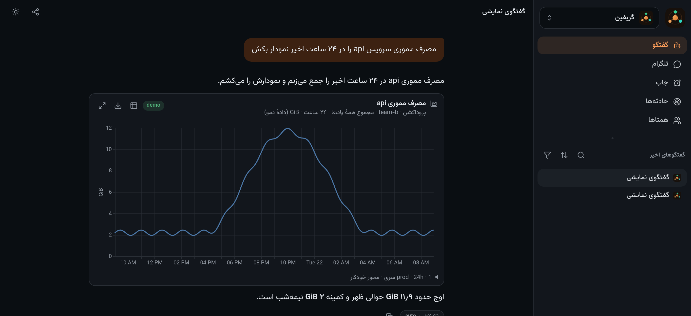

# Griffin — your own team of AI agents

[](https://github.com/paziresh24/Griffin/stargazers)
[](https://github.com/paziresh24/Griffin/actions/workflows/ci.yml)
[](LICENSE)
[](https://github.com/paziresh24/Griffin/releases)
[](https://griffin.paziresh24.com/)

**A self-hosted shell for a small team of AI agents that work for you.** You make the agents — what
each one is, what it may touch, who may ask it — and they answer from typed tools instead of from
the model's memory. Use it as a personal assistant on Telegram, a research or writing helper, an
assistant your colleagues can message, an MCP backend for Claude Code, or an operations agent wired
to your own systems — on Claude, Cursor or any OpenAI-compatible model, including local ones.

`Node 24` · `Cursor, Claude Agent SDK or any OpenAI-compatible API` · `SQLite` · no SaaS control plane · MIT

**Website:** [griffin.paziresh24.com](https://griffin.paziresh24.com/) · [Use cases](https://griffin.paziresh24.com/use-cases.html) · [Self-hosted AI agents](https://griffin.paziresh24.com/self-hosted-ai-agent.html) · [Telegram AI assistant](https://griffin.paziresh24.com/telegram-ai-assistant.html) · [MCP server](https://griffin.paziresh24.com/mcp-server.html) · [فارسی](https://griffin.paziresh24.com/fa/)

<picture>
  <source media="(prefers-color-scheme: dark)" srcset="docs/media/demo-dark.gif">
  
</picture>

## Two minutes to your own

**On a Linux server** — one command checks the machine, installs Docker if it is missing, pulls the
image and starts Griffin:

```bash
curl -fsSL https://griffin.paziresh24.com/install.sh | bash
```

It prints the address to open and how to read the login token. Run the same line again to update: the
new version replaces the old one only once it is healthy, and your data stays in Docker volumes.
Options go before `bash` (`curl … | GRIFFIN_PORT=3200 GRIFFIN_PROXY=http://host:port bash`); see the
top of [`docs/install.sh`](docs/install.sh) for all of them.

**With Docker you already have** — one line, no clone, no key needed up front:

```bash
docker run -d --name griffin --restart unless-stopped -p 3100:3100 -v griffin-data:/data -v griffin-workspace:/workspace \
  ghcr.io/paziresh24/griffin:latest
docker exec griffin cat /data/owner.token   # the token you log in with
```

Open `http://127.0.0.1:3100`, log in, and the **setup wizard** walks you through it: pick an engine
(Claude subscription token from `claude setup-token`, Anthropic API key, OpenAI, OpenRouter, a local
Ollama, any OpenAI-compatible endpoint, or Cursor), paste the key, and it is tested with a real call
on the spot — a rejected key, a region block, a network problem or an empty balance each say so in
plain words. Then name your assistant and, if you like, connect a Telegram or Bale bot.

Prefer env? `-e ANTHROPIC_API_KEY=…` (an `sk-ant-oat…` subscription token works too),
`-e OPENAI_API_KEY=…` with `-e GRIFFIN_OPENAI_BASE_URL=…`, or `-e CURSOR_API_KEY=…`. Behind a
firewall or in a blocked region, set an outgoing proxy in the wizard (or `-e GRIFFIN_PROXY=http://host:port`).
For Ollama on the same machine add `--add-host=host.docker.internal:host-gateway`.
No key yet? `-e GRIFFIN_DEMO=1` runs a scripted demo.

**From source:**

```bash
git clone https://github.com/paziresh24/Griffin.git griffin && cd griffin
npm ci && npm run build

mkdir -p data workspace
echo "sk-ant-…" > data/anthropic.api-key && chmod 600 data/anthropic.api-key   # or openai.api-key / cursor.api-key
GRIFFIN_DATA=./data GRIFFIN_WORKSPACE=./workspace PORT=3100 node apps/server/src/index.mjs
```

Open `http://127.0.0.1:3100`, log in with the token at `data/owner.token`, and start talking to the
agent that is already there (no key file? the setup wizard opens first). No cluster, no vault, no YAML: a fresh install is a chat with one
agent, and everything else is something you add when you want it.

Or stay in the terminal:

```bash
node bin/griffin.mjs "summarise what I asked you this week"   # streams the answer
node bin/griffin.mjs -i                                       # keep the chat open
node bin/griffin.mjs agents                                   # who exists, what they may use
```

`docker compose -f deploy/compose.yaml up -d --build` builds and runs the same thing from source.

To look around before wiring anything up, `GRIFFIN_DEMO=1 GRIFFIN_AUTH=off …` replaces the model
with a scripted stand-in — the screenshots on this page are that demo.

## It checks and repairs itself

**Settings → Health** runs a live check: every engine gets a real call (and the reason it fails),
agents sitting on an engine that does not answer, recent runs that failed or came back empty, stuck
runs, messenger connections, disk space and the last server errors — each with a one-click fix and
the wizard that sets it right. Every 15 minutes the same check repairs what is safe on its own: an
agent whose engine rejects its key or is region-blocked moves to an engine that answers, and moves
back once its own engine heals; stuck runs are stopped. The assistant has the same check as tools
(`self_check`, `self_fix`), so "it does not work" is something you can ask it about.
`GRIFFIN_SELF_HEAL=off` keeps the report and turns the automatic part off;
`node bin/griffin.mjs doctor` prints the report in a terminal.

## Make an agent

**#/agents → ایجنت جدید**: an id, a name, one line about its job, and its instructions. Then switch
on the tools it may use, and say who may call it — the owner, another agent, a scheduled job, a
colleague on a messenger, or an external agent over MCP — and which of its tools each of them gets.

Agents are rows in a table, not code. Quotas are enforced where tools are handed to the model, so a
tool a caller was not given does not exist for that run. [`docs/agents.md`](docs/agents.md) explains
the model; [`examples/agents/`](examples/agents) has profiles you can import as a starting point
(a personal assistant, a writer, a researcher that only reads — and, if you run servers, a platform
agent and two CDN agents).

## What you get

**Agents that delegate.** `delegate` returns immediately and reports back when the subtask lands, so
the agent you are talking to stays free; `ask_agent` is the short blocking variant. Each agent picks
its own engine (Cursor, Claude, or any OpenAI-compatible endpoint) and model.

**Charts and files in the conversation** — the agent draws Vega-Lite from real rows, and images,
video, PDF, Markdown and CSV render inline. The same chart goes to a messenger as an image.



**Scheduled jobs** — a prompt, a trigger and a delivery target; each run gets its own hidden chat,
so a job that misbehaves leaves the same trace a person's chat would.

**Messengers and other agents** — Telegram/Bale bots and a Telegram account bridge; an MCP endpoint
where another agent (Claude Code, for instance) connects with its own scoped token and gets
task-shaped tools: send, wait, reply, cancel.

**Threads with colleagues.** On a Telegram account bridge, a colleague's DM opens a Griffin thread
only when a small classifier says it is real work (thanks and small talk stay yours); the thread
closes with the result, and messages that arrive while it works are answered together, once.

**Rehearse before it talks to anyone.** A simulation chat runs the whole delegation tree for real
but records side effects instead of executing them; `apps/server/scripts/eval.mjs` replays
scenarios against it and checks the answers.

**No interface, when that is better.** The core is the product; the UI is one client of it. There is
a terminal client, a Bearer-authenticated HTTP API, MCP for other agents, messengers, and scheduled
jobs that deliver where you already are — and `GRIFFIN_WEB=off` runs the whole thing headless. See
[docs/interfaces.md](docs/interfaces.md).

**Tools for your own systems, if you want them.** A separate broker process holds credentials and
exposes typed tools. The packs that ship today are operational — Kubernetes (status, get, logs,
in-pod `df`, secrets, CNPG), Prometheus and Grafana, PostgreSQL, S3, GitLab, MikroTik routers,
ArvanCloud and NSIN CDNs, DNS/HTTP/TLS probes — and a new pack is one module with a schema. Each pack
appears only once you configure what it needs, so an agent never sees a tool that cannot work.

The UI speaks English and Persian (right-to-left), picked from your browser and switchable in Settings.

## Use it as an MCP server

Griffin is also an MCP server: Claude Code, Claude Desktop, Cursor or any other MCP client can hand
it a task and follow it to the end (`griffin_send`, `griffin_wait`, `griffin_reply`,
`griffin_cancel`, `griffin_tasks`, `griffin_limits`). Each client gets its own scoped token from **#/peers**.

```bash
# streamable HTTP (Claude Code)
claude mcp add --transport http griffin https://griffin.example.com/mcp --header "Authorization: Bearer grf_…"
```

For stdio-only clients, `bin/griffin-mcp.mjs` bridges stdio to the same endpoint and needs no
`npm install`:

```json
{ "mcpServers": { "griffin": { "command": "node", "args": ["/path/to/griffin/bin/griffin-mcp.mjs"],
  "env": { "GRIFFIN_URL": "https://griffin.example.com", "GRIFFIN_TOKEN": "grf_…" } } } }
```

## How it fits together

```
browser · Telegram · MCP client
            │
     ┌──────▼─────────────────────────┐
     │ app     chats, agents, jobs,   │  holds the model key
     │         charts, files, MCP     │  no infrastructure credentials, no shell
     └──────┬─────────────────────────┘
            │ unix socket · typed JSON tools     (optional)
     ┌──────▼─────────────────────────┐
     │ broker  kube · metrics · pg    │  holds every credential
     │         s3 · gitlab · routers  │  guards enforced in code
     └────────────────────────────────┘  public API first, emergency SSH second
```

The split is the point: the process running the model holds no credential and has no shell, and the
process that holds them exposes only named tools with schemas. More in
[docs/architecture.md](docs/architecture.md).

## Connect your own systems (optional)

1. Copy `config/site.example.json` to `config/site.json` and describe your world: clusters and their
   emergency SSH paths, GitLab, object storage, routers, shell hosts.
2. Put the credentials in a vault (OpenBao/Vault KV) — [`docs/configuration.md`](docs/configuration.md)
   lists the item names the broker looks up.
3. Start the broker: `COMPOSE_PROFILES=tools docker compose -f deploy/compose.yaml up -d --build`.
4. In **#/agents**, switch the new tools on for the agent that should have them — or import
   `examples/agents/platform.json` and edit it.

**This repository ships no environment.** There are no hosts, clusters, tokens or organisation
knowledge in it: unconfigured tools say "not configured" instead of guessing an endpoint, and the
tests declare their own fixture site.

## Layout

| Path | What |
|---|---|
| `apps/server/` | Hono + SQLite + SSE, agent runtime, auth, jobs, incidents, MCP |
| `apps/broker/` | every credential, typed tools over a unix socket, guards in code |
| `apps/web/` | the UI (assistant-ui + streamdown, RTL, PWA) |
| `packages/timeline/` | folds stored events into messages (shared by server and UI) |
| `config/` | the site inventory shape |
| `examples/agents/` | importable agent profiles |
| `deploy/` | compose, environment example, egress proxy notes, backup script |
| `bin/griffin.mjs` | the terminal client |
| `bin/griffin-mcp.mjs` | MCP over stdio, forwarding to a Griffin server |
| `docs/` | [agents](docs/agents.md) · [interfaces](docs/interfaces.md) · [architecture](docs/architecture.md) · [configuration](docs/configuration.md) |

## Security posture

- The agent process has no shell tool and no infrastructure credential; the broker holds them. Tools
  that *use* a credential (cluster, router, CDN, GitLab) never hand it to the model, and copy tools
  return key names only. The two tools whose job is to *read* a secret — `infisical_get` and
  `kube_secret` — do return the value to the model; those results are masked in stored events and
  logs, and the value is masked again if it later appears in another tool call. Remove
  them from a caller's quota if a caller should never see secret values.
- Tool access is filtered per caller before the tools reach the model — quota is code, not prompt
  text — and a caller with no quota row gets nothing.
- Write tools are narrow by construction: router changes only touch items Griffin itself created, S3
  is GET/HEAD only, `gitlab_propose` opens a draft MR on a new branch and never merges, secret copies
  return key names only.
- Irreversible actions ask the owner and wait; in an unattended chain (a job, the ops room) they are
  refused rather than guessed. Every approval is recorded.
- Owner auth is local: the token in `data/owner.token` becomes a signed cookie in the browser, or a
  `Bearer` credential for the terminal and scripts. It keeps working when your SSO is down. Put it
  behind TLS you control; it is not built to face the open internet unauthenticated.

Read the code before you point this at production: it is opinionated, and the guards assume one
owner.

## License

MIT — see [LICENSE](LICENSE).
